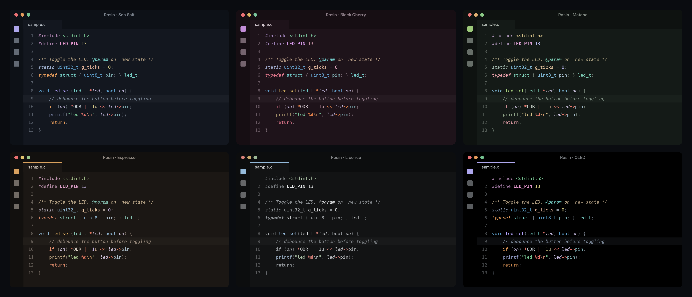

<p align="center">
  
</p>

<h1 align="center">Rosin</h1>

<p align="center">Calm, low-glare dark themes for VS Code, where every colour means the same thing in every language.</p>

<p align="center">
  <a href="https://marketplace.visualstudio.com/items?itemName=debjoy-howlader.rosin-theme"></a>
  <a href="https://github.com/debjoy-howlader/rosin-theme/releases/latest"></a>
  <a href="https://github.com/debjoy-howlader/rosin-theme"></a>
</p>



## Flavours

- Rosin · Sea Salt
- Rosin · Black Cherry
- Rosin · Matcha
- Rosin · Espresso
- Rosin · Licorice
- Rosin · OLED

## Highlights

- **The whole window is themed.** Every colour VS Code lets a theme set (about 970 of them) is set in all six flavours. That covers the editor, panels, terminal, diff and merge views, testing, debugging, notebooks, chat and the settings editor.
- **Built for semantic highlighting.** Tuned for C/C++ IntelliSense and clangd, rust-analyzer and Pylance. Globals, statics, `const` values, parameters and library calls are each distinguishable.
- **Toolchains as well as languages.** Makefiles, CMake, shell, PowerShell, TOML, INI, YAML, Dockerfiles, diffs and git get the same care. Assembly, linker-script and devicetree grammars get it too, when an extension provides them.
- **Readable logs.** In `.log` files, errors, warnings, info and debug lines each get their own colour. ESP-IDF style (`E (512) tag:`) and Zephyr style (`<err>`) levels are recognised, along with panic and fault messages.
- **Contrast checked.** Body text is above WCAG AA in every flavour, while comments and punctuation are deliberately quieter.

## Colours

<!-- colours:start -->
### Rosin · Sea Salt

| | Meaning | Example | Hex |
|:-:|---|---|---|
|  | Editor background |  | `#13171F` |
|  | Panels / sidebar |  | `#0D1117` |
|  | Selection |  | `#333A5F` |
|  | UI accent |  | `#AEA7ED` |
|  | Text / variable | `count` `buf` | `#C6CDD4` |
|  | Keyword / control flow | `if` `for` `return` | `#E59B5B` |
|  | Qualifier | `const` `static` `extern` | `#9CADCB` |
|  | Function | `led_set()` | `#B5A4FF` |
|  | Method | `.write()` | `#C0B2FF` |
|  | Library / builtin function | `printf` `memcpy` | `#8D96BE` |
|  | Macro (bold) | `LED_PIN` `println!` | `#E497CE` |
|  | Preprocessor / attribute | `#include` `#[derive]` | `#AB81AD` |
|  | Namespace / module | `std` `core::ptr` | `#6F9895` |
|  | Primitive type | `int` `uint8_t` `u32` | `#5EA0CD` |
|  | User type / type keyword | `struct` `led_t` `trait` | `#75CCC4` |
|  | Parameter / self (italic) | `len` `self` | `#C2B7DB` |
|  | Member / key / CLI flag | `.pin` `name:` `--baud` | `#7DABB0` |
|  | Global / config variable | `g_ticks` `$(CC)` | `#DEAF97` |
|  | Static variable | `s_state` | `#ADC6A8` |
|  | Number / constant / enum | `42` `0xFF` `true` | `#D5C984` |
|  | String | `"hello"` | `#75C290` |
|  | Escape | `\n` `&amp;` | `#CB8871` |
|  | Hazard: pointer / bits / format | `*` `->` `<<` `%d` | `#E2726B` |
|  | Operator | `=` `+` `==` | `#8A939E` |
|  | Punctuation | `;` `,` `{}` | `#6A727D` |
|  | Comment (italic) | `// note` | `#7A8696` |
|  | Doc comment (italic) | `/// returns` | `#AE9B7F` |
|  | Error / log error | `ERROR` | `#E97074` |
|  | Warning / log warning | `WARN` | `#E59B5B` |
|   | Diff added / removed | `+` / `-` | `#75C290` `#E97074` |

### Rosin · Black Cherry

| | Meaning | Example | Hex |
|:-:|---|---|---|
|  | Editor background |  | `#1E131A` |
|  | Panels / sidebar |  | `#160E13` |
|  | Selection |  | `#462D4B` |
|  | UI accent |  | `#C28DD7` |
|  | Text / variable | `count` `buf` | `#D4C8CF` |
|  | Keyword / control flow | `if` `for` `return` | `#DB7489` |
|  | Qualifier | `const` `static` `extern` | `#A1ABCC` |
|  | Function | `led_set()` | `#DAB663` |
|  | Method | `.write()` | `#DCC27B` |
|  | Library / builtin function | `printf` `memcpy` | `#AA966E` |
|  | Macro (bold) | `LED_PIN` `println!` | `#D297E5` |
|  | Preprocessor / attribute | `#include` `#[derive]` | `#A184BB` |
|  | Namespace / module | `std` `core::ptr` | `#6F9896` |
|  | Primitive type | `int` `uint8_t` `u32` | `#649FCB` |
|  | User type / type keyword | `struct` `led_t` `trait` | `#74CCCB` |
|  | Parameter / self (italic) | `len` `self` | `#C1B7DC` |
|  | Member / key / CLI flag | `.pin` `name:` `--baud` | `#7DABB0` |
|  | Global / config variable | `g_ticks` `$(CC)` | `#DEB49B` |
|  | Static variable | `s_state` | `#ADC6A8` |
|  | Number / constant / enum | `42` `0xFF` `true` | `#ECB0C6` |
|  | String | `"hello"` | `#79C49C` |
|  | Escape | `\n` `&amp;` | `#C89164` |
|  | Hazard: pointer / bits / format | `*` `->` `<<` `%d` | `#E3814A` |
|  | Operator | `=` `+` `==` | `#9D8C97` |
|  | Punctuation | `;` `,` `{}` | `#7C6C76` |
|  | Comment (italic) | `// note` | `#957D8C` |
|  | Doc comment (italic) | `/// returns` | `#B39982` |
|  | Error / log error | `ERROR` | `#E97074` |
|  | Warning / log warning | `WARN` | `#DAB663` |
|   | Diff added / removed | `+` / `-` | `#79C49C` `#E97074` |

### Rosin · Matcha

| | Meaning | Example | Hex |
|:-:|---|---|---|
|  | Editor background |  | `#141A17` |
|  | Panels / sidebar |  | `#0E1210` |
|  | Selection |  | `#374831` |
|  | UI accent |  | `#9CC97A` |
|  | Text / variable | `count` `buf` | `#CBD4CB` |
|  | Keyword / control flow | `if` `for` `return` | `#E8A0AA` |
|  | Qualifier | `const` `static` `extern` | `#A2B8AE` |
|  | Function | `led_set()` | `#A8D17E` |
|  | Method | `.write()` | `#B8DA92` |
|  | Library / builtin function | `printf` `memcpy` | `#93A88C` |
|  | Macro (bold) | `LED_PIN` `println!` | `#DFA2D6` |
|  | Preprocessor / attribute | `#include` `#[derive]` | `#B49AC0` |
|  | Namespace / module | `std` `core::ptr` | `#73A08E` |
|  | Primitive type | `int` `uint8_t` `u32` | `#7FB8D6` |
|  | User type / type keyword | `struct` `led_t` `trait` | `#7CCBB4` |
|  | Parameter / self (italic) | `len` `self` | `#C8BFDA` |
|  | Member / key / CLI flag | `.pin` `name:` `--baud` | `#A3B9C8` |
|  | Global / config variable | `g_ticks` `$(CC)` | `#E2C39E` |
|  | Static variable | `s_state` | `#B9D0A8` |
|  | Number / constant / enum | `42` `0xFF` `true` | `#B9B8EE` |
|  | String | `"hello"` | `#D8C38A` |
|  | Escape | `\n` `&amp;` | `#D9A274` |
|  | Hazard: pointer / bits / format | `*` `->` `<<` `%d` | `#E57A6E` |
|  | Operator | `=` `+` `==` | `#8E9C92` |
|  | Punctuation | `;` `,` `{}` | `#6C796F` |
|  | Comment (italic) | `// note` | `#7E8D82` |
|  | Doc comment (italic) | `/// returns` | `#AEA382` |
|  | Error / log error | `ERROR` | `#EC7A7A` |
|  | Warning / log warning | `WARN` | `#E0B070` |
|   | Diff added / removed | `+` / `-` | `#8CCB86` `#EC7A7A` |

### Rosin · Espresso

| | Meaning | Example | Hex |
|:-:|---|---|---|
|  | Editor background |  | `#1B1714` |
|  | Panels / sidebar |  | `#12100E` |
|  | Selection |  | `#4C3B27` |
|  | UI accent |  | `#D9A15E` |
|  | Text / variable | `count` `buf` | `#DDD2C6` |
|  | Keyword / control flow | `if` `for` `return` | `#DE8C6C` |
|  | Qualifier | `const` `static` `extern` | `#B5ACBA` |
|  | Function | `led_set()` | `#E8B565` |
|  | Method | `.write()` | `#EEC47F` |
|  | Library / builtin function | `printf` `memcpy` | `#B59D7A` |
|  | Macro (bold) | `LED_PIN` `println!` | `#DA9DC6` |
|  | Preprocessor / attribute | `#include` `#[derive]` | `#BB91AC` |
|  | Namespace / module | `std` `core::ptr` | `#8AA59C` |
|  | Primitive type | `int` `uint8_t` `u32` | `#8DB2CD` |
|  | User type / type keyword | `struct` `led_t` `trait` | `#86C2B2` |
|  | Parameter / self (italic) | `len` `self` | `#CEC0D8` |
|  | Member / key / CLI flag | `.pin` `name:` `--baud` | `#AABAC5` |
|  | Global / config variable | `g_ticks` `$(CC)` | `#E7C4A1` |
|  | Static variable | `s_state` | `#BDC9A5` |
|  | Number / constant / enum | `42` `0xFF` `true` | `#C7B5E4` |
|  | String | `"hello"` | `#A9C48E` |
|  | Escape | `\n` `&amp;` | `#D8A26C` |
|  | Hazard: pointer / bits / format | `*` `->` `<<` `%d` | `#E3785E` |
|  | Operator | `=` `+` `==` | `#A2968C` |
|  | Punctuation | `;` `,` `{}` | `#7C7066` |
|  | Comment (italic) | `// note` | `#918376` |
|  | Doc comment (italic) | `/// returns` | `#B7A487` |
|  | Error / log error | `ERROR` | `#EA7070` |
|  | Warning / log warning | `WARN` | `#E3C46F` |
|   | Diff added / removed | `+` / `-` | `#9AC68C` `#EA7070` |

### Rosin · Licorice

| | Meaning | Example | Hex |
|:-:|---|---|---|
|  | Editor background |  | `#121314` |
|  | Panels / sidebar |  | `#0C0D0E` |
|  | Selection |  | `#2A3540` |
|  | UI accent |  | `#94B9DA` |
|  | Text / variable | `count` `buf` | `#CACCCE` |
|  | Keyword / control flow | `if` `for` `return` | `#8E9296` |
|  | Qualifier | `const` `static` `extern` | `#868A8E` |
|  | Function | `led_set()` | `#94B9DA` |
|  | Method | `.write()` | `#A7C6E2` |
|  | Library / builtin function | `printf` `memcpy` | `#8FA2B5` |
|  | Macro (bold) | `LED_PIN` `println!` | `#E4E6E8` |
|  | Preprocessor / attribute | `#include` `#[derive]` | `#808488` |
|  | Namespace / module | `std` `core::ptr` | `#7F8387` |
|  | Primitive type | `int` `uint8_t` `u32` | `#A6AAAE` |
|  | User type / type keyword | `struct` `led_t` `trait` | `#D6D8DA` |
|  | Parameter / self (italic) | `len` `self` | `#B9BCBF` |
|  | Member / key / CLI flag | `.pin` `name:` `--baud` | `#B3B6B9` |
|  | Global / config variable | `g_ticks` `$(CC)` | `#E8E9EA` |
|  | Static variable | `s_state` | `#C0C3C6` |
|  | Number / constant / enum | `42` `0xFF` `true` | `#DDDFE1` |
|  | String | `"hello"` | `#A7BDA2` |
|  | Escape | `\n` `&amp;` | `#C3C7CA` |
|  | Hazard: pointer / bits / format | `*` `->` `<<` `%d` | `#D9827A` |
|  | Operator | `=` `+` `==` | `#8A8E92` |
|  | Punctuation | `;` `,` `{}` | `#66696D` |
|  | Comment (italic) | `// note` | `#7A7E82` |
|  | Doc comment (italic) | `/// returns` | `#8F9397` |
|  | Error / log error | `ERROR` | `#D9827A` |
|  | Warning / log warning | `WARN` | `#C9A66B` |
|   | Diff added / removed | `+` / `-` | `#9CB896` `#D9827A` |

### Rosin · OLED

| | Meaning | Example | Hex |
|:-:|---|---|---|
|  | Editor background |  | `#000000` |
|  | Panels / sidebar |  | `#000000` |
|  | Selection |  | `#2A2840` |
|  | UI accent |  | `#AEA7ED` |
|  | Text / variable | `count` `buf` | `#C6CDD4` |
|  | Keyword / control flow | `if` `for` `return` | `#E59B5B` |
|  | Qualifier | `const` `static` `extern` | `#9CADCB` |
|  | Function | `led_set()` | `#B5A4FF` |
|  | Method | `.write()` | `#C0B2FF` |
|  | Library / builtin function | `printf` `memcpy` | `#8D96BE` |
|  | Macro (bold) | `LED_PIN` `println!` | `#E497CE` |
|  | Preprocessor / attribute | `#include` `#[derive]` | `#AB81AD` |
|  | Namespace / module | `std` `core::ptr` | `#6F9895` |
|  | Primitive type | `int` `uint8_t` `u32` | `#5EA0CD` |
|  | User type / type keyword | `struct` `led_t` `trait` | `#75CCC4` |
|  | Parameter / self (italic) | `len` `self` | `#C2B7DB` |
|  | Member / key / CLI flag | `.pin` `name:` `--baud` | `#7DABB0` |
|  | Global / config variable | `g_ticks` `$(CC)` | `#DEAF97` |
|  | Static variable | `s_state` | `#ADC6A8` |
|  | Number / constant / enum | `42` `0xFF` `true` | `#D5C984` |
|  | String | `"hello"` | `#75C290` |
|  | Escape | `\n` `&amp;` | `#CB8871` |
|  | Hazard: pointer / bits / format | `*` `->` `<<` `%d` | `#E2726B` |
|  | Operator | `=` `+` `==` | `#8A939E` |
|  | Punctuation | `;` `,` `{}` | `#6A727D` |
|  | Comment (italic) | `// note` | `#7A8696` |
|  | Doc comment (italic) | `/// returns` | `#AE9B7F` |
|  | Error / log error | `ERROR` | `#E97074` |
|  | Warning / log warning | `WARN` | `#E59B5B` |
|   | Diff added / removed | `+` / `-` | `#75C290` `#E97074` |

<!-- colours:end -->

## Install

1. Open the Extensions view (`Ctrl+Shift+X`) and search for **Rosin**.
2. Install it, then run **Preferences: Color Theme** and pick a **Rosin · …** flavour.

Offline or on a fork of VS Code? Download the `.vsix` from the [latest release](https://github.com/debjoy-howlader/rosin-theme/releases/latest) and run **Extensions: Install from VSIX…**.

### Recommended settings

```jsonc
"editor.semanticHighlighting.enabled": true,
"editor.bracketPairColorization.enabled": true
```

## Building from source

The theme files are generated. To change a palette, edit the flavour tables in `tools/gen.py`, then run:

```sh
python tools/gen.py             # writes themes/*.json
python tools/readme_assets.py   # redraws the preview, swatches and colour tables (needs Pillow)
npx @vscode/vsce package        # builds the .vsix
```

To release, bump `version` in `package.json`, add a `CHANGELOG.md` entry, then push a matching tag (`git tag v1.0.2 && git push --tags`). A GitHub Action builds the `.vsix` and attaches it to a new release.

## License

MIT
